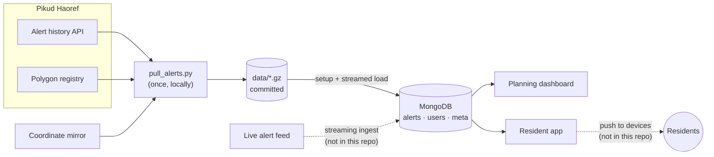

# Alert Zone Store

A batch database of Israeli Home Front Command (Pikud Haoref) civil-defence
alerts: 585,939 records from 2023-10-07 to 2026-09-10, stored in MongoDB and
indexed for the questions the people using it actually ask.

## What it's for

| Who | What they ask | Served by |
|---|---|---|
| A regional council's emergency coordinator | How often was my council alerted, where, and when did it spike? | `municipality_en` + `timestamp` |
| A national planner | Which regions get the least warning time, and how many alerts does that affect? | `region_en`, `shelter_time_seconds` |
| A resident, through an app | Which alerts for my area have I not been shown yet? | `users` watermark + `zone` + `timestamp` |

Alerts per month for one regional council:

```js
db.alerts.aggregate([
  { $match: { municipality_en: "Misgav Regional Council", message_type: "alert" } },
  { $group: { _id: { $substr: ["$timestamp", 0, 7] }, alerts: { $sum: 1 } } },
  { $sort: { _id: 1 } }
])
```

Alerts by shelter time across the country:

```js
db.alerts.aggregate([
  { $match: { message_type: "alert" } },
  { $group: { _id: "$shelter_time_seconds", alerts: { $sum: 1 } } },
  { $sort: { _id: 1 } }
])
```

## Where it fits

This repository is the storage layer of a larger alerting system. It is filled
in batch from a one-time pull; the dashboard and the resident app read from it.
The live feed and delivery to devices are streaming concerns and sit outside it.



## Run it

```bash
docker compose up --build
```

or, without Compose:

```bash
docker build -t alert-zone-store .
docker run -p 27017:27017 alert-zone-store
```

Either way one container starts the official MongoDB image, runs
`setup_db.py` to create the collections, validators and indexes, then streams
the committed dataset in with `load_to_mongo.py`. It logs
`Ready: alerts_db is loaded` and reports `healthy` once the load has finished,
in well under a minute. Nothing contacts the live API.

## Verify

With the container running:

```bash
pip install -r requirements.txt
python3 scripts/test_dataset.py      # dataset and database invariants
python3 scripts/subscriptions.py     # per-user delivery demo
```

## Layout

| Path | Role |
|---|---|
| `DESIGN.md` | Why MongoDB, the alternatives, and the risk register |
| `Dockerfile`, `compose.yaml`, `docker/start.sh` | One container: MongoDB, then setup, then load |
| `scripts/setup_db.py` | Collections, schema validators and indexes. Safe to re-run |
| `scripts/load_to_mongo.py` | Streams the dataset in batches of 1,000. Idempotent |
| `scripts/subscriptions.py` | Per-user delivery state and the query that reads it |
| `scripts/test_dataset.py` | Checks on the dataset file and the loaded database |
| `scripts/pull_alerts.py` | The one-time acquisition. Runs locally, from Israel only |
| `data/alerts_clean.jsonl.gz` | The normalised dataset, one document per line. This is what gets loaded |
| `data/alerts_raw.json.gz` | The untouched API records |
| `data/ref_*.json.gz` | Reference snapshots taken with the pull |

## Data sources

| Source | Provides |
|---|---|
| `alerts-history.oref.org.il` history API | The alert records |
| Pikud Haoref polygon registry (`GetDistricts.aspx`, `districts_*.json`) | Region, shelter time, local authority, English names |
| `tzevaadom.co.il` | Coordinates, which the official registry lacks |

Each field comes from the source that sets it. The API only answers Israeli IP
addresses.

## Data model

Three collections:

- **`alerts`**, one document per alert per polygon
- **`users`**, one document per subscriber: their polygons and a delivery watermark
- **`meta`**, a record of the last completed load: file, SHA-256, document count, time

Alerts are issued per **polygon**, not per city. Large cities are split so a
siren can sound for the threatened part only: Haifa is 7 polygons, Jerusalem 7,
Tel Aviv 4. Three levels of place follow from that:

| Field | Example | Meaning |
|---|---|---|
| `zone` | `חיפה - מערב` (Haifa – West) | The polygon a siren is raised for |
| `city` | `חיפה` (Haifa) | The city a polygon belongs to, derived from its name |
| `municipality` | `Misgav Regional Council` | The local authority responsible for it: 611 in total |

```json
{
  "_id": "27795:חיפה - בת גלים ק.אליעזר",
  "alert_id": 27795,
  "event_id": "2024-01-19T20:45:00|1",
  "category": 1,
  "category_desc": "ירי רקטות וטילים",
  "message_type": "alert",
  "zone": "חיפה - בת גלים ק.אליעזר",
  "zone_en": "Haifa - Bat Galim, Kiryat Eliezer",
  "zone_id": "2330",
  "city": "חיפה",
  "city_en": "Haifa",
  "municipality": "חיפה",
  "municipality_en": "Haifa",
  "region": "חיפה",
  "region_en": "Haifa",
  "shelter_time_seconds": 90,
  "timestamp": "2024-01-19T20:45:00",
  "lat": 32.8277,
  "lng": 34.9801
}
```

Text fields are kept in the source's Hebrew. Each place field has an English
counterpart ending in `_en`; `category_desc` does not, so the descriptions are
translated below.

| `category_desc` | English | `message_type` |
|---|---|---|
| `ירי רקטות וטילים` | Rocket and missile fire | `alert` |
| `חדירת כלי טיס עוין` | Hostile aircraft intrusion | `alert` |
| `התקרבו למרחב מוגן` | Move toward a protected space | `alert` |
| `איום מלבנון - התקרבו למרחב מוגן` | Threat from Lebanon: move toward a protected space | `alert` |
| `חדירת מחבלים` | Terrorist infiltration | `alert` |
| `רעידת אדמה` | Earthquake | `alert` |
| `בדקות הקרובות צפויות להתקבל התרעות באזורך` | Alerts are expected in your area in the coming minutes | `pre_alert` |
| `האירוע הסתיים` | The event has ended | `all_clear` |
| `ירי רקטות וטילים -  האירוע הסתיים` | Rocket and missile fire: the event has ended (note the double space, as in the source) | `all_clear` |
| `חדירת כלי טיס עוין - האירוע הסתיים` | Hostile aircraft intrusion: the event has ended | `all_clear` |
| `ניתן לצאת מהמרחב המוגן` | You may leave the protected space | `all_clear` |
| `ניתן לצאת מהמרחב המוגן אך יש להישאר בקרבתו` | You may leave the protected space but should stay near it | `all_clear` |
| `מבזק` | News flash | `info` |
| `שהייה בסמיכות למרחב מוגן` | Stay near a protected space | `info` |
| `סיום שהייה בסמיכות למרחב המוגן` | You no longer need to stay near the protected space | `info` |
| `פיקוד העורף מעדכן` | Home Front Command update | `info` |

These cover 99.8% of records. The rest are rarer shelter instructions and the all-clears for infiltration and earthquake alerts.

`message_type` separates the 173,851 actual alerts from all-clears (199,550),
pre-alerts (198,309) and bulletins (14,229). Counting every row as an alert
overstates alert frequency roughly threefold. The source `category` code cannot
make the split on its own, so the description text is used as well.

The `alerts` validator requires only `zone`, `timestamp`, `category` and
`message_type`. Any other field is accepted, so a new alert type can carry new
fields without a migration.

## Reliability

Every document has a deterministic `_id` of `rid:zone`, and the load is an
upsert on it, so loading twice changes nothing. The API's `rid` is not unique on
its own: it identifies a barrage and repeats across every polygon the barrage
covers.

The container runs setup and load on every start and Compose restarts it on
failure, so an interrupted load completes itself. Killing the loader with
`SIGKILL` 188,000 documents in, Docker restarted the container and the load
finished with 585,939 documents and no duplicates. A normal restart reports
`0 inserted or changed`.

The loader streams the file, so its memory stays around 30 MiB whatever the
dataset size.

## Acquisition

The history API silently truncates any response at 3,000 rows and, on heavy
days, returns rows from other dates. `pull_alerts.py` therefore asks for one
polygon at a time across the whole window using the `city_0` parameter. The
heaviest polygon returns 1,334 rows, well under the cap.

`city_0` only recognises current polygon names, so alerts filed under
since-retired polygons are taken from whole-day responses instead, from days
that came back under the cap and only where each row's date matches the day
requested. That adds 1,479 records.

## Per-user delivery

A `users` document holds the polygons someone is subscribed to and a
`last_delivered_ts` watermark. Delivery returns alerts newer than the watermark
in those polygons, then moves the watermark forward. It moves only after the
batch is handed over, so a crash sends an alert twice rather than not at all.

Subscriptions are stored per polygon. A resident of one Haifa polygon has 277
alerts in this dataset; the whole city has 893, so subscribing them to "Haifa"
would send them 616 alerts that were not for them.

## Known limitations

- **Region and shelter time are today's values.** Pikud Haoref has redrawn
  its regional map (30 regions to 33) and changed shelter times, and publishes
  only current values. A 2023 alert therefore carries today's shelter time for
  its polygon, not the one in force when the siren sounded.
- **0.3% of rows have no region or shelter time.** Historical alerts carry the
  polygon name as it was then, and some names have since been renamed, respelled
  or split. Those fields stay `null` rather than being guessed.
- **Polygons are not towns.** Some cover several localities (`שדרות, איבים`, Sderot and Ibim).
- **Centre points only.** No source gives polygon boundaries, so subscriptions
  match by polygon name, not by location.
- **No authentication.** MongoDB runs without access control, which is fine on
  a local machine and must change before it is exposed anywhere else.
